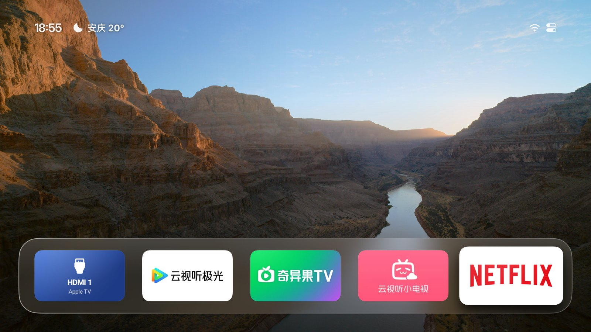

# Aerial TV (Xiaomi / HyperOS TV Mod)

> **针对小米电视 / 红米智能显示器（HyperOS TV / Android 14）定制的 Apple TV 4K 航拍桌面开源方案与预编译产物。**  
> 源码与下载：[https://github.com/lajidePM/aerial-tv-mod](https://github.com/lajidePM/aerial-tv-mod)

---

## 方案对比与技术原理

| 维度 | 方案 A：无障碍守护模式（安全版） | 方案 B：白名单变异编译模式（终极版） |
| :--- | :--- | :--- |
| **开发思路** | 借鉴 **Projectivy Launcher (PRO桌面)** 的无障碍按键拦截与前台守护机制，二次改造源码注入守护 | 逆向提取小米预置桌面白名单槽位，直接将 Aerial 源码包名变异 |
| **包名机制** | 官方包名 `app.orchard.tv`，注入 `HomeGuardService` | 变异包名为 `com.ts.launcher`（系统预留启动器槽位） |
| **原厂桌面** | **保留运行**（`com.mitv.tvhome` 保持开启） | **底层冻结**（`pm disable-user --user 0 com.mitv.tvhome`） |
| **变砖风险** | **零风险**（不改动任何系统级组件，随时卸载即还原） | **极低**（需严格遵循 ADB 绑定与顺序，已提供一键回滚脚本） |
| **Home键体验** | 返回桌面时偶有 0.1 秒原厂界面过渡 | **0 闪烁、0 延迟**，原生直达，与 Apple TV 体验一致 |
| **内存开销** | 原厂桌面常驻后台（占用约 350MB 运存） | 彻底释放原厂桌面内存，系统运存更充裕 |
| **适用人群** | 新手用户、怕麻烦、不想承担任何风险者 | 极客玩家、强迫症、追求绝对纯净与极致流畅者 |

---

## 方案 A 实操指南（无障碍守护模式）

### 1. 技术思路
Projectivy Launcher (PRO桌面) 在 Android TV 领域广为人知的核心优势在于其**无障碍覆盖层守护**。我们在 Aerial 中引入了相同的思路：
- 应用不注册系统级 `CATEGORY_HOME`，避免被系统看门狗当场拦截或覆盖；
- 后台启动 `AccessibilityService`，持续监听遥控器按键与前台应用变化；
- 当检测到用户按下遥控器主页键（Home）或前台切回原厂桌面时，守护服务立即将 Aerial 拉至最前台。

### 2. 部署命令
下载 Release 中的 `aerial-tv-v1.61-accessibility-guard.apk`：
```bash
# 1. 安装 APK
adb install -r aerial-tv-v1.61-accessibility-guard.apk

# 2. 授予受限权限通道（Android 13/14 必须）
adb shell cmd appops set app.orchard.tv ACCESS_RESTRICTED_SETTINGS allow

# 3. 激活无障碍守护服务
adb shell settings put secure enabled_accessibility_services app.orchard.tv/.guard.HomeGuardService
```

---

## 方案 B 实操指南（白名单变异模式 · 推荐）

### 1. 技术思路
小米电视系统内部维护了一份可信任的第三方启动器白名单，其中 `com.ts.launcher`（原厂合作办公/展示桌面）可以直接被设置为首选桌面而不被系统看门狗强制杀后台。
本方案将 Aerial 源码中的 `applicationId` 直接定制编译为 `com.ts.launcher`，使其具备系统白名单身份。

### 2. 部署命令
下载 Release 中的 `aerial-tv-v1.61-whitelist-com.ts.launcher.apk`：
```bash
# 1. 确保原厂桌面处于启用状态（防黑屏安全前提）
adb shell pm enable com.mitv.tvhome

# 2. 安装白名单版 APK
adb install -r aerial-tv-v1.61-whitelist-com.ts.launcher.apk

# 3. 授予系统特权并进行 AOT 满血机器码编译（提升流畅度）
adb shell cmd appops set com.ts.launcher ACCESS_RESTRICTED_SETTINGS allow
adb shell pm grant com.ts.launcher android.permission.WRITE_SECURE_SETTINGS
adb shell pm compile -m speed -f com.ts.launcher

# 4. 绑定为系统默认主桌面
adb shell cmd package set-home-activity --user 0 com.ts.launcher

# 5. 校验当前 Home 绑定（必须确认 isDefault=true）
adb shell "cmd package resolve-activity -a android.intent.action.MAIN -c android.intent.category.HOME"

# 6. 验证无误后，安全冻结原厂桌面
adb shell pm disable-user --user 0 com.mitv.tvhome
```

### 3. 三大实操避坑关键
1. **Manifest 别名歧义致命坑**：
   - 源码 `AndroidManifest.xml` 中**绝不可同时声明多个带有 `CATEGORY_HOME` 的 Activity 或 Alias**。如果存在多个别名，Android 框架会调起 `ResolverActivity`（系统桌面选择器），但在原厂桌面冻结后，HyperOS 的选择器无法正常渲染，导致屏幕黑屏假死。
2. **执行顺序必须严格遵守**：
   - 必须先完成 `set-home-activity` 并确保新桌面被成功解析为默认主页，最后一步才允许执行 `disable-user` 原厂桌面。
3. **彻底清理旧无障碍守护**：
   - 如果先前使用过方案 A 或旧版 Aerial，必须先卸载 `app.orchard.tv` 并清除 `enabled_accessibility_services`，否则旧守护会与新白名单桌面发生前台抢占，导致应用列表焦点频繁重置回到第一个图标。

---

## 应急回滚（一键恢复原厂）

若操作过程中遇到任何显示异常，通过无线/有线 ADB 执行以下指令即可秒级还原原厂系统：
```bash
# 一键唤醒并恢复原厂桌面
adb shell pm enable com.mitv.tvhome
adb shell cmd package set-home-activity --user 0 com.mitv.tvhome
adb shell am start -n com.mitv.tvhome/com.mitv.tvhome.MainActivity
```

---

## 开源产物与 Release 下载

编译完成的 APK 与源码改动详见本仓库 Releases：
- [Releases 页面](https://github.com/lajidePM/aerial-tv-mod/releases)
  - `aerial-tv-v1.61-whitelist-com.ts.launcher.apk` (方案 B：白名单 0 闪烁版)
  - `aerial-tv-v1.61-accessibility-guard.apk` (方案 A：无障碍守护免变砖版)

---

# 以下为 Upstream 官方原版 README

<div align="center">


# Aerial

**给国产电视的一块干净桌面。**

参照 Apple TV 做的 Android TV 桌面：没有广告，没有推荐流，只有你的 App、壁纸和航拍屏保。<br>
适合小米、TCL、创维、索尼等国产电视，也能装在盒子和投影仪上。开机自动进入，待机也不会被清理。

**中文** · [English](README.en.md)

<a href="https://aerial.qust.me"></a>
<a href="https://github.com/pengchujin/aerial-tv/releases/latest"></a>
<a href="#安装"></a>

<a href="https://github.com/pengchujin/aerial-tv/releases/latest"></a>
<a href="LICENSE"></a>

<a href="#lite"></a>



| 电视自带的桌面 | 换上 Aerial 之后 |
|:---:|:---:|
|  |  |

</div>

## 功能

- **首页**：常用的一排 App 放在屏幕下方的玻璃底板上，往下是全部 App。小米「应用中心」「米家」这类藏起来的系统 App 也在。
- **整理**：长按 OK 键（或按菜单键）可以移动、放进文件夹、隐藏、卸载。固定到主屏幕的 HDMI 可以选接的是 Apple TV、PlayStation、Switch、Xbox、电脑等，换成对应的图标，也能在手机上起名字。
- **用手机整理**：扫电视上的二维码，手机上就是和电视一样的图标网格：按住拖动排序，点一下改名、换图标、放进文件夹或隐藏，也能把 HDMI 等信号源加到主屏幕。
- **控制中心**：在第一排按上键到右上角打开，有信号源、网络、设置、音量、亮度和个性化。
- **屏保**：Apple TV 的 114 段航拍影片，电视支持时播 4K 或 4K 杜比视界，也可以换成照片、时钟或从手机添加的本地视频。
- **壁纸**：必应每日精选、14 张内置壁纸、用手机扫码传的照片，或者航拍：停在主屏幕 10 秒后在磁贴后面播放，按任意键停在当前画面。
- **个性化**：单排或双排、时钟大小和位置、App 名称、焦点样式、按键声音，都能改。

---

## 声明与致谢 (Credits & Acknowledgements)

本项目基于优秀开源项目及社区实践经验二次修改与适配，特此向以下上游项目及作者致以诚挚的敬意与感谢：

1. **[pengchujin/aerial-tv](https://github.com/pengchujin/aerial-tv)** (MIT License)
   - 本项目的核心 UI 架构、tvOS 风格极简设计、Apple 航拍视频源及原生桌面接管基础均来自 @pengchujin 的 Aerial TV 原作。
   - 感谢原作者为国产 Android TV 生态带来如此优雅纯净的极简桌面。

2. **[spocky/miproja1 (Projectivy Launcher)](https://github.com/spocky/miproja1)**
   - 感谢 Projectivy Launcher 团队在 Android TV 领域探索出的按键拦截与无障碍守护前置理念，为本项目的方案 A（无障碍魔改免变砖版）提供了关键技术灵感与思路。

3. **[fandejin/tv-terminator](https://github.com/fandejin/tv-terminator)**
   - 感谢社区在小米电视预置白名单启动器（`com.ts.launcher`）替身方案上的实践验证，为方案 B（白名单变异 0 闪烁版）的系统看门狗放行提供了重要参考。

---

### 开源许可 (License)
本项目源码遵循上游的 **MIT License**，保留原版权声明与许可，欢迎社区共同交流完善。
